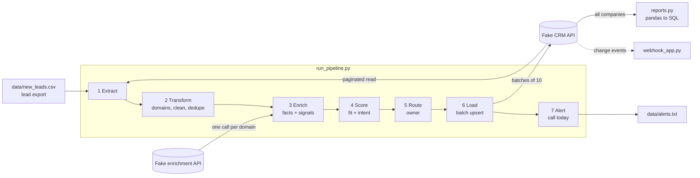

# 3. Architecture: how the pieces connect

## The data flow

## The components

| Component | File | Role | Real-world equivalent |
| --- | --- | --- | --- |
| Lead export | `data/new_leads.csv` | Messy input with deliberate traps | A CSV from Apollo, LinkedIn, an event list |
| Fake API server | `fake_api/server.py` | Plays two services; misbehaves on purpose | An enrichment provider + HubSpot |
| Config | `src/config.py` | Every setting in one place | Same |
| HTTP helper | `src/http_utils.py` | Every API call goes through retries | Same (often a shared library) |
| Extract | `src/extract.py` | Read CSV, CRM (paginated), enrichment | Connectors to each source |
| Transform | `src/transform.py` | Normalise, drop non-companies, dedupe | Same, sometimes in SQL in a warehouse |
| Score | `src/score.py` | Fit + intent with reasons | Lead/account scoring model |
| Route | `src/route.py` | Assign owners | Lead routing (e.g. round-robin rules) |
| Load | `src/load.py` | Batch upsert to CRM | Same, or "reverse ETL" from a warehouse |
| Alerts | `src/alerts.py` | Call-today messages | Slack alerts to reps |
| AI opener | `src/ai_opener.py` | Optional Claude step with validation | AI research/drafting agents |
| Orchestrator | `src/run_pipeline.py` | Runs steps in order, logs, handles failure | A scheduled job (cron, GitHub Actions, Airflow) |
| Webhook | `src/webhook_app.py` | Reacts to CRM events instantly, once | Same, deployed on a server |
| Reports | `src/reports.py` | SQL on CRM data | Dashboards, warehouse queries |
| Tests | `tests/` | Check the decision logic | Same, run in CI |

## Key design decisions (and why)

| Decision | Why | The alternative and its problem |
| --- | --- | --- |
| **Domain is the unique key** for a company | Names vary ("PeopleCo GmbH" / "Peopleco"); domains rarely do | Matching on names creates duplicates |
| **Website first, email domain as fallback** | Some leads have no website but a work email | Dropping them loses real companies |
| **Drop personal email domains** | A gmail address isn't a company | They'd pollute the CRM |
| **Keep the most complete row** when merging duplicates | Don't lose information | Keeping the first row may keep the emptiest |
| **Every API call goes through one retry function** | Rate limits and outages are normal | Scattered try/excepts; inconsistent behaviour |
| **Retry 429/5xx; never retry other 4xx** | Temporary vs permanent errors | Retrying a bad request wastes calls and hides bugs |
| **Respect `Retry-After`** | The server knows best how long to wait | Hammering makes the limit worse |
| **Fill gaps from enrichment, don't overwrite** | The lead data may be more specific | Overwriting can replace good data with worse |
| **Batch upsert by domain** | Idempotent (safe re-runs), fewer calls | Create-only duplicates on every run |
| **Never send blanks to the CRM** | Don't erase good data | Empty values overwrite real ones |
| **The CRM owns name and owner of existing records** | Field ownership: humans may have edited them | The pipeline would undo people's work |
| **Score has reasons** | Reps trust and use explainable scores | A bare number gets ignored |
| **One bad record doesn't stop the run** | Partial success beats total failure | One typo kills the whole run |
| **Summary line + failure alert** | You know it ran, and you know when it didn't | Silent failures |
| **Pure functions for logic** | Easy to test | Logic mixed with API calls can't be tested offline |
| **`--dry-run`** | Test safely on real data | Testing in production |

## How it would look in production

| This project | Production |
| --- | --- |
| Fake API server | Real HubSpot (service key) + a real enrichment provider |
| CSV input | Several sources, maybe a data warehouse |
| Run by hand | Scheduled every few hours (cron, GitHub Actions, AWS) |
| `processed` set in the webhook | A database table, so it survives restarts |
| Alerts to a file | Slack messages to each owner |
| Logs to a file | Central logging + dashboards + alerts on anomalies |
| Webhook on localhost | Deployed on a server with a public HTTPS URL and signature checks |
| 19 leads | Thousands, so throttling, incremental runs and caching matter |

Next: run it ([../README.md](../README.md)), then [04_code_walkthrough.md](04_code_walkthrough.md)
